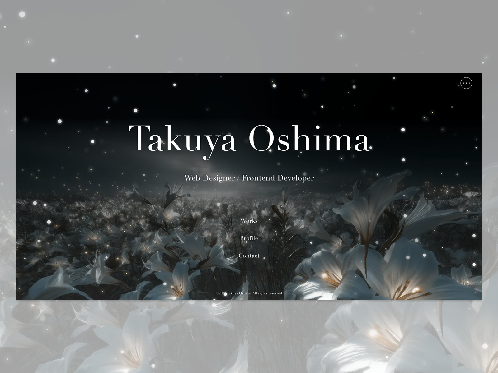

# Takuya Oshima Portfolio

UIデザイナー / フロントエンドエンジニア 大島卓也のポートフォリオサイトです。
企画、Figmaでのワイヤーフレーム・UIデザインから、フロントエンド実装、CMS設計、運用までを一人で手がけています。

サイト：https://takuya-oshima.com/ja/

## 受賞歴

- [CSS Design Awards](https://www.cssdesignawards.com/sites/takuya-oshima-portfolio/48030/)：Special Kudos / Best UI / Best UX / Best Innovation の4賞を受賞（2025年9月）
- [Awwwards](https://www.awwwards.com/sites/takuya-oshima-portfolio)：Nominee（2025年9月）
- [CSS Winner](https://www.csswinner.com/details/takuya-oshima-portfolio/18804)：STAR賞（2025年8月）



## 技術スタック

| 分類 | 使用技術 |
| --- | --- |
| デザイン | Figma |
| フレームワーク | Next.js（App Router）/ React |
| 言語 | TypeScript |
| スタイリング | Tailwind CSS / CSS Modules / CSS変数 |
| アニメーション | GSAP / Lenis / tsParticles |
| 多言語対応 | next-intl（日本語 / 英語） |
| CMS | microCMS |
| ホスティング | Vercel |
| その他 | ESLint / Git / GitHub |

## 主な機能

- 日本語 / 英語の切り替え（言語ごとのURL、メタ情報、OGPの出し分け）
- ダーク / ライトテーマの切り替え
- 実績（Works）の一覧・詳細ページ（microCMSから取得）
- オープニングアニメーション（トップページの初回訪問時のみ表示）
- スクロールに連動したアニメーション

## デザインコンセプト

**ゲームのUIを、Webで体験できるポートフォリオ**

これまで触れてきたゲーム、アニメ、映画の演出から着想を得て、特にゲームのUIをモチーフにデザインしました。
情報の見やすさよりも表現を優先し、デザインアワードでの評価を目標に制作しています。
国内だけでなく海外の人にも楽しんでもらえるよう、日本語と英語の切り替えにも対応しました。

- コンシューマーゲーム（ニーア オートマタ、ファイナルファンタジーなど）のスタート画面、メニューUI、エフェクトの表現から着想を得て、Web向けに再構成
- Works詳細ページの「DETAILS」は、映画のエンドクレジットをモチーフにデザイン
- 書体は、海外のハイブランドのファッション誌で使われるような、洗練された印象のものを採用

## 設計・実装で工夫した点

### デザインから実装まで一貫して担当
Figmaでワイヤーフレームとデザインを制作し、そのままNext.js / TypeScriptで実装しています。
デザインと実装を同じ人が担当することで、アニメーションや細かな表現もデザインの意図どおりに再現しています。

### コンポーネント設計
UIを30以上のコンポーネントに分割し、1コンポーネント1ディレクトリで管理しています。
レイアウトなどの汎用的なスタイルはTailwind CSS、コンポーネント固有のスタイルはCSS Modulesで書いています。

### スタイルの一元管理
テーマカラーをCSS変数で定義し、ダーク / ライトの切り替えをCSS変数の差し替えだけで実現しています。

### CMSと型定義
実績データはmicroCMSで管理し、TypeScriptで型を定義したうえで取得しています。
コードを変更せずに、CMSから実績を追加・更新できます。

### 表示速度への配慮
アニメーションを多用するサイトのため、次の設定で表示速度の低下を抑えています。

- 画像のWebP配信
- CSSの最適化
- 静的ファイルのキャッシュ設定
- 本番環境でのconsole出力の削除

## ディレクトリ構成

```
src/
├── app/
│   └── [locale]/        # 言語ごとのページ（トップ / works / profile / contact）
├── components/          # UIコンポーネント（1コンポーネント1ディレクトリ）
├── constants/           # 定数
├── i18n/                # 多言語対応の設定
├── libs/                # microCMSのクライアント、共通処理
└── styles/              # グローバルCSS
messages/                # 翻訳ファイル（ja.json / en.json）
```

## ローカルでの起動方法

```bash
npm install
npm run dev
```

`.env.local` に以下の環境変数が必要です。

```
MICROCMS_SERVICE_DOMAIN=xxxx
MICROCMS_API_KEY=xxxx
```

## 作者

大島卓也（Takuya Oshima）
- Portfolio：https://takuya-oshima.com/ja/
- GitHub：https://github.com/takuya-oshima
